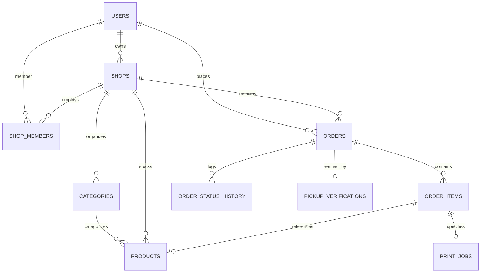

# LocalPickup — Database Architecture & SaaS Design

## 1. Architectural Justification & Database Selection

### Current State Analysis
LocalPickup initially persisted data within a flat JSON file (`backend/data.json`). While convenient for prototyping, flat JSON storage presents critical architectural limitations for a multi-tenant SaaS application:
1. **Lack of Concurrency & Write Race Conditions**: Concurrency is limited to single-process in-memory locks. Multiple Node instances or concurrent customer checkouts can overwrite file contents or result in lost updates.
2. **Absence of Referential Integrity**: There are no foreign key constraints enforcing that an order item belongs to an existing shop's product or that an uploaded document belongs to an existing order.
3. **Lack of True Atomic Transactions**: A multi-item order that fails partway through inventory reservation cannot execute a rollback without manual error-prone compensatory code.
4. **Linear Scaling Inefficiencies**: Every read requires loading and parsing the entire database into memory ($O(N)$ memory and CPU).

### Relational Engine Selection: SQLite with `node:sqlite`
For the MVP and regional multi-shop SaaS deployment, **SQLite (via Node 24 native `node:sqlite` / `DatabaseSync`)** is chosen over PostgreSQL or continuing with flat JSON.

| Feature / Metric | Flat JSON | Embedded SQLite (`node:sqlite`) | PostgreSQL |
| :--- | :--- | :--- | :--- |
| **ACID Transactions** | ❌ None | ✅ Full ACID transactions with rollback | ✅ Full ACID transactions |
| **Foreign Key Constraints** | ❌ None | ✅ Enforced via `PRAGMA foreign_keys = ON` | ✅ Fully enforced |
| **Concurrency Support** | ❌ Prone to overwrite races | ✅ High concurrency with WAL journal mode | ✅ High concurrency |
| **Operational Overhead** | Low | Low (zero external services/daemons) | High (requires database server, auth, backups) |
| **Deployment Footprint** | Embedded file | Single self-contained `.db` file | External server or container |
| **Node.js Integration** | `fs/promises` | Native Node 24 C-level embedded engine | Network TCP driver (`pg`) |

**Decision**: Embedded SQLite provides full relational integrity, foreign keys, transactions, and indexing with **zero external server dependencies** and maximum execution speed on the local machine. The schema is designed using standard SQL types (`TEXT`, `INTEGER`, `REAL`), enabling seamless future migration to PostgreSQL as tenant load scales.

---

## 2. Entity-Relationship Diagram (ERD)



---

## 3. Relational Schema Specification

### 3.1 `users`
Stores all platform accounts (customers, shop owners, staff, and platform administrators).

```sql
CREATE TABLE users (
    id TEXT PRIMARY KEY,
    email TEXT UNIQUE NOT NULL COLLATE NOCASE,
    password_hash TEXT NOT NULL,
    name TEXT NOT NULL,
    global_role TEXT NOT NULL CHECK(global_role IN ('ADMIN', 'PLATFORM_ADMIN', 'CUSTOMER', 'SHOP_OWNER', 'SHOPKEEPER', 'SHOP_STAFF')) DEFAULT 'CUSTOMER',
    created_at TEXT NOT NULL DEFAULT (datetime('now')),
    updated_at TEXT NOT NULL DEFAULT (datetime('now'))
);

CREATE INDEX idx_users_email ON users(email);
```

### 3.2 `shops`
Digital storefront profile for each registered business tenant.

```sql
CREATE TABLE shops (
    id TEXT PRIMARY KEY,
    name TEXT NOT NULL,
    slug TEXT UNIQUE,
    description TEXT,
    distance TEXT,
    price_starting TEXT,
    rating REAL DEFAULT 5.0,
    owner_id TEXT NOT NULL REFERENCES users(id) ON DELETE RESTRICT,
    subscription_status TEXT NOT NULL CHECK(subscription_status IN ('TRIAL', 'ACTIVE', 'SUSPENDED', 'CANCELLED')) DEFAULT 'TRIAL',
    address TEXT,
    phone TEXT,
    pricing_config_json TEXT, -- JSON configuration for document printing rates
    created_at TEXT NOT NULL DEFAULT (datetime('now')),
    updated_at TEXT NOT NULL DEFAULT (datetime('now'))
);

CREATE INDEX idx_shops_owner ON shops(owner_id);
```

### 3.3 `shop_members`
Implements multi-tenant shop staff and ownership access control.

```sql
CREATE TABLE shop_members (
    id TEXT PRIMARY KEY,
    shop_id TEXT NOT NULL REFERENCES shops(id) ON DELETE CASCADE,
    user_id TEXT NOT NULL REFERENCES users(id) ON DELETE CASCADE,
    role TEXT NOT NULL CHECK(role IN ('OWNER', 'STAFF')) DEFAULT 'STAFF',
    created_at TEXT NOT NULL DEFAULT (datetime('now')),
    updated_at TEXT NOT NULL DEFAULT (datetime('now')),
    UNIQUE(shop_id, user_id)
);

CREATE INDEX idx_shop_members_user ON shop_members(user_id);
CREATE INDEX idx_shop_members_shop ON shop_members(shop_id);
```

### 3.4 `categories`
Organizes shop inventory into categories (e.g. "Paper Products", "Writing Supplies", "Binding").

```sql
CREATE TABLE categories (
    id TEXT PRIMARY KEY,
    shop_id TEXT NOT NULL REFERENCES shops(id) ON DELETE CASCADE,
    name TEXT NOT NULL,
    slug TEXT NOT NULL,
    sort_order INTEGER DEFAULT 0,
    created_at TEXT NOT NULL DEFAULT (datetime('now')),
    UNIQUE(shop_id, slug)
);

CREATE INDEX idx_categories_shop ON categories(shop_id);
```

### 3.5 `products`
Physical stationery products offered by shops.

```sql
CREATE TABLE products (
    id TEXT PRIMARY KEY,
    shop_id TEXT NOT NULL REFERENCES shops(id) ON DELETE CASCADE,
    category_id TEXT REFERENCES categories(id) ON DELETE SET NULL,
    name TEXT NOT NULL,
    description TEXT,
    price REAL NOT NULL CHECK(price >= 0),
    stock_quantity INTEGER NOT NULL DEFAULT 0 CHECK(stock_quantity >= 0),
    is_available INTEGER NOT NULL DEFAULT 1 CHECK(is_available IN (0, 1)),
    image_url TEXT,
    created_at TEXT NOT NULL DEFAULT (datetime('now')),
    updated_at TEXT NOT NULL DEFAULT (datetime('now'))
);

CREATE INDEX idx_products_shop ON products(shop_id);
CREATE INDEX idx_products_category ON products(category_id);
```

### 3.6 `orders`
Unifies self-pickup customer bookings for printing services and stationery products.

```sql
CREATE TABLE orders (
    id TEXT PRIMARY KEY,
    shop_id TEXT NOT NULL REFERENCES shops(id) ON DELETE RESTRICT,
    customer_id TEXT REFERENCES users(id) ON DELETE SET NULL,
    customer_name TEXT,
    customer_email TEXT,
    pickup_time TEXT NOT NULL,
    pickup_token TEXT NOT NULL,
    pickup_token_hash TEXT NOT NULL,
    total_amount REAL NOT NULL CHECK(total_amount >= 0),
    status TEXT NOT NULL CHECK(status IN ('Pending', 'Accepted', 'Preparing', 'Ready', 'Completed', 'Rejected', 'Cancelled')) DEFAULT 'Pending',
    verified_by_user_id TEXT REFERENCES users(id) ON DELETE SET NULL,
    verified_at TEXT,
    created_at TEXT NOT NULL DEFAULT (datetime('now')),
    updated_at TEXT NOT NULL DEFAULT (datetime('now'))
);

CREATE INDEX idx_orders_shop ON orders(shop_id);
CREATE INDEX idx_orders_customer ON orders(customer_id);
CREATE INDEX idx_orders_status ON orders(status);
```

### 3.7 `order_items`
Itemized lines in an order (products or printing jobs).

```sql
CREATE TABLE order_items (
    id TEXT PRIMARY KEY,
    order_id TEXT NOT NULL REFERENCES orders(id) ON DELETE CASCADE,
    product_id TEXT REFERENCES products(id) ON DELETE SET NULL,
    item_type TEXT NOT NULL CHECK(item_type IN ('PRODUCT', 'PRINT_JOB')),
    title TEXT NOT NULL,
    quantity INTEGER NOT NULL CHECK(quantity >= 1),
    unit_price REAL NOT NULL CHECK(unit_price >= 0),
    subtotal REAL NOT NULL CHECK(subtotal >= 0)
);

CREATE INDEX idx_order_items_order ON order_items(order_id);
```

### 3.8 `print_jobs`
Specialized print parameters and document storage references attached to an order.

```sql
CREATE TABLE print_jobs (
    id TEXT PRIMARY KEY,
    order_id TEXT NOT NULL REFERENCES orders(id) ON DELETE CASCADE,
    order_item_id TEXT REFERENCES order_items(id) ON DELETE CASCADE,
    original_file_name TEXT NOT NULL,
    storage_key TEXT NOT NULL,
    file_path TEXT NOT NULL,
    file_mime TEXT,
    file_size_bytes INTEGER,
    paper_size TEXT NOT NULL CHECK(paper_size IN ('A4', 'A3')),
    color_mode TEXT NOT NULL CHECK(color_mode IN ('bw', 'colour')),
    sides TEXT NOT NULL CHECK(sides IN ('single', 'double')),
    copies INTEGER NOT NULL CHECK(copies >= 1),
    binding INTEGER NOT NULL DEFAULT 0 CHECK(binding IN (0, 1)),
    lamination INTEGER NOT NULL DEFAULT 0 CHECK(lamination IN (0, 1)),
    calculated_price REAL NOT NULL CHECK(calculated_price >= 0)
);

CREATE INDEX idx_print_jobs_order ON print_jobs(order_id);
```

### 3.9 `order_status_history`
Audit log recording every lifecycle transition of an order.

```sql
CREATE TABLE order_status_history (
    id TEXT PRIMARY KEY,
    order_id TEXT NOT NULL REFERENCES orders(id) ON DELETE CASCADE,
    from_status TEXT,
    to_status TEXT NOT NULL,
    changed_by_user_id TEXT REFERENCES users(id) ON DELETE SET NULL,
    changed_by_name TEXT,
    note TEXT,
    created_at TEXT NOT NULL DEFAULT (datetime('now'))
);

CREATE INDEX idx_status_history_order ON order_status_history(order_id);
```

### 3.10 `pickup_verifications`
Immutable audit record generated upon customer pickup verification at the shop counter.

```sql
CREATE TABLE pickup_verifications (
    id TEXT PRIMARY KEY,
    order_id TEXT NOT NULL UNIQUE REFERENCES orders(id) ON DELETE CASCADE,
    verified_by_user_id TEXT NOT NULL REFERENCES users(id) ON DELETE RESTRICT,
    verified_by_name TEXT NOT NULL,
    verified_at TEXT NOT NULL DEFAULT (datetime('now')),
    method TEXT NOT NULL CHECK(method IN ('MANUAL_CODE', 'QR_SCAN')) DEFAULT 'MANUAL_CODE'
);
```

### 3.11 `schema_migrations`
Tracks executed migrations to prevent duplicate runs and ensure repeatability.

```sql
CREATE TABLE schema_migrations (
    id INTEGER PRIMARY KEY AUTOINCREMENT,
    name TEXT NOT NULL UNIQUE,
    applied_at TEXT NOT NULL DEFAULT (datetime('now'))
);
```

---

## 4. Tenant Isolation Strategy

### Server-Side Ownership Determination
1. **Never trust client-supplied shop IDs or customer IDs**:
   - The user identity is extracted authoritatively from the validated JWT token (`req.user.id`).
2. **Shop Scoping**:
   - Every shop owner and staff member belongs to records in `shop_members`.
   - Any query or mutation accessing shop orders, products, inventory, or private documents checks:
     ```sql
     SELECT 1 FROM shop_members 
     WHERE shop_id = ? AND user_id = ?;
     ```
   - If not found and the user is not `PLATFORM_ADMIN`, the request is immediately rejected with HTTP `403 Forbidden`.
3. **Customer Scoping**:
   - Customers can only query orders where `customer_id = req.user.id` or `customer_email = req.user.email`.
4. **Public Storefront Scoping**:
   - Storefront routes (`GET /api/shops`, `GET /api/shops/:id`) expose only public attributes (`id`, `name`, `description`, `price_starting`, `rating`, `distance`, `address`, `phone`).
   - Private orders, customer identities, staff memberships, and document storage keys are never exposed on public endpoints.

---

## 5. Migration & Rollback Procedures

### Pre-Migration Backup
Before running schema initialization:
- `backend/data.json` is copied to `backend/data.backup.<timestamp>.json`.
- SQLite database is created in WAL mode with foreign keys enabled:
  ```sql
  PRAGMA journal_mode = WAL;
  PRAGMA foreign_keys = ON;
  ```

### Rollback Strategy
If any migration step fails:
1. The migration runs inside an explicit transaction (`BEGIN TRANSACTION` ... `ROLLBACK`).
2. In case of unexpected disk or execution errors, the original `backend/data.backup.<timestamp>.json` remains untouched and can be restored.
3. Record counts and foreign key integrity are verified before finalizing.
