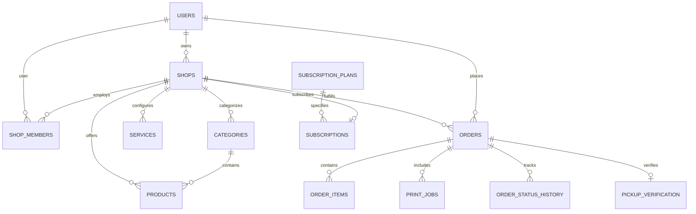

# LocalPickup - Multi-Tenant SaaS Implementation Plan

## 1. Executive Summary & Existing Architecture

**LocalPickup** is a multi-tenant SaaS platform designed for local businesses—specifically printing and stationery shops—enabling college students and local customers to pre-order printing jobs and physical stationery items for rapid self-pickup without waiting in lines.

### Existing Architecture Overview
- **Backend Stack**:
  - Runtime: Node.js (v24.21.0) with TypeScript.
  - Framework: Express.js (v5.2.1) using CommonJS module resolution (`tsx watch`).
  - Storage / Database: Flat JSON file (`backend/data.json`) read/written with `fs/promises`.
  - File Uploads: Multer with static file serving from `backend/uploads/` via `express.static`.
  - Security / Auth: Minimal mockup. Unhashed plaintext passwords in `data.json`, no JWT or token exchange, no authorization headers, and no role-based permission checks on endpoints.
- **Frontend Stack**:
  - Runtime: Vite 8.3 + React 19 + React Router v7.
  - Styling: Vanilla CSS (`index.css`) with CSS custom properties.
  - Utilities: `qrcode.react` for rendering QR codes on the order confirmation screen.
  - State / Auth: User profile JSON stored in browser `localStorage`. No JWT token, no Authorization header in HTTP requests.

---

## 2. Existing Functionality

| Module | Feature | Existing Status | Deficiencies / Observations |
| :--- | :--- | :--- | :--- |
| **Discovery** | Browse Shops (`/shops`) | Working | Hardcoded search input without functional filters; displays list from `/api/shops`. |
| **Shop Profile**| Shop Details (`/shops/:id`)| Working | Displays shop header; service cards hardcoded in frontend (only Document Printing is active). |
| **Printing Workflow**| Print Configuration (`/print`) | Working | Calculates prices on frontend; handles paper size (A4/A3), color (bw/color), sides (single/double), copies, binding, and lamination. |
| **Pickup Scheduling**| Choose Slot (`/pickup`)| Working | Static list of timeslots; sends `FormData` including client-computed total to `POST /api/orders`. |
| **Order Confirmation**| Booking Success (`/booking-success`)| Working | Displays QR code encoded with order ID; order details summary. |
| **Customer Orders**| My Bookings (`/bookings`)| Broken / Insecure | Calls `GET /api/orders`, returning **all** orders across **all** shops and users without filtering. |
| **Shop Dashboard**| Order Dashboard (`/dashboard`)| Broken / Insecure | Hardcoded to query shop 1; fetches **all** orders platform-wide; status transitions directly from Pending -> Ready -> Completed without verification. |
| **Admin Panel**| Admin Portal (`/admin`)| Insecure | Client-only check for `user.role === 'ADMIN'`; can toggle subscription status between `ACTIVE` and `SUSPENDED` with unauthenticated `PATCH /api/admin/shops/:id/subscription`. |
| **Authentication**| Login / Register (`/login`)| Insecure | Plaintext passwords stored in `data.json`; no token issued; anyone can self-register with any role (`ADMIN`, `SHOPKEEPER`, `CUSTOMER`). |

---

## 3. Security Vulnerabilities & Architectural Flaws

1. **Missing Authentication & Token Verification (CWE-306, CWE-287)**:
   - There are no tokens (JWT / session) issued upon login or registration.
   - All API endpoints (`/api/orders`, `/api/orders/:id/status`, `/api/admin/*`, `/api/shops/*`) accept unauthenticated requests.
2. **Broken Object-Level Authorization (BOLA / IDOR) (CWE-639)**:
   - `GET /api/orders` returns the entire order history of the system to anyone who calls it.
   - Any user or shop can patch the status of any order in the database via `PATCH /api/orders/:id/status`.
3. **Public Exposure of Private Customer Documents (CWE-552, CWE-200)**:
   - Uploaded files are served via `app.use("/uploads", express.static(...))`.
   - File paths are sequential/timestamped (`1790444664624-e1.png`), easily guessable or scraped. Any student document, confidential assignment, or personal ID is publicly readable on the Internet.
4. **Untrusted Client-Side Pricing (CWE-602)**:
   - The backend blindly accepts `total: parseFloat(total)` from the client's `POST /api/orders` request body. A malicious user can submit `total: 0.01` or a negative price.
5. **Insecure Password Storage (CWE-256, CWE-312)**:
   - Passwords (`password123`, `123456`) are stored in raw plaintext in `data.json`.
6. **Privilege Escalation on Registration (CWE-269)**:
   - `POST /api/auth/register` accepts a `role` field directly from the body. Any user can register as `ADMIN` or `SHOPKEEPER`.
7. **Predictable Order Identifiers & Pickup Verification (CWE-330)**:
   - Order IDs are generated as `"LP-" + Date.now().toString().slice(-6)`. They are sequential and predictable.
   - There is no cryptographic pickup token. No atomic single-use verification mechanism exists.
8. **Lack of Rate Limiting & Denial of Service Vulnerabilities (CWE-770, CWE-400)**:
   - Multer has no file size limit (`limits: { fileSize: ... }`).
   - No rate limiting on login, registration, or order creation.
   - No file MIME/extension inspection; any executable or arbitrary payload can be uploaded.
9. **Missing Environment Validation & Insecure Fallbacks**:
   - No `.env` or `.env.example`. Hardcoded port `5000`. No production secret enforcement.

---

## 4. Missing Functionality

1. **Stationery & Product Catalog**:
   - Products model (pens, notebooks, record books, files, art supplies).
   - Category management (Paper Products, Writing Instruments, Office Supplies).
   - Stock & inventory tracking (reserve on order, restore on cancellation).
2. **Unified Cart & Checkout**:
   - Combined checkout for printing services and stationery products under a single shop.
   - Prevention of cross-shop mixing in a single pickup order.
3. **Shop Management Dashboard**:
   - Shop profile customization (name, description, contact, pickup hours, pricing rules).
   - Product and inventory management (create, edit, archive, stock updates).
   - Order preparation management with granular statuses.
4. **Order Lifecycle & Atomic Pickup Verification**:
   - Granular statuses: `Pending` -> `Accepted` -> `Preparing` -> `Ready for Pickup` -> `Completed` (or `Rejected` / `Cancelled`).
   - Cryptographically random pickup code and QR token.
   - Shop staff verification portal with single-use atomic completion.
5. **In-App Notifications**:
   - Notification feed for customers when orders are accepted, ready, or completed.
   - Sound/badge indicators for shopkeepers receiving new incoming orders.
6. **Platform Administration & SaaS Subscriptions**:
   - Platform dashboard for tenant monitoring, subscription plan management, shop approval, suspension, and auditing.
   - Multi-tenant isolation verified by automated tests.

---

## 5. Proposed Database Changes (SaaS Schema)

To support the multi-tenant architecture and product catalog while preserving existing data, the schema will be evolved cleanly:

### Key Entities
1. **Users**: `id`, `email`, `passwordHash`, `name`, `role` (`PLATFORM_ADMIN`, `SHOP_OWNER`, `SHOP_STAFF`, `CUSTOMER`), `createdAt`, `updatedAt`.
2. **Shops**: `id`, `name`, `slug`, `description`, `ownerId`, `address`, `phone`, `rating`, `subscriptionStatus` (`TRIAL`, `ACTIVE`, `SUSPENDED`, `CANCELLED`), `pricingConfig`, `pickupHours`, `createdAt`.
3. **ShopMembers**: `id`, `shopId`, `userId`, `role` (`OWNER`, `STAFF`), `createdAt`.
4. **Categories**: `id`, `shopId`, `name`, `slug`.
5. **Products**: `id`, `shopId`, `categoryId`, `name`, `description`, `price`, `stockQuantity`, `isAvailable`, `imageUrl`, `createdAt`.
6. **Orders**: `id`, `orderNumber`, `shopId`, `customerId`, `customerName`, `customerEmail`, `status`, `totalAmount`, `pickupSlot`, `pickupTokenHash`, `createdAt`, `updatedAt`.
7. **OrderItems**: `id`, `orderId`, `productId`, `productName`, `quantity`, `unitPrice`, `subtotal`.
8. **PrintJobs**: `id`, `orderId`, `originalFileName`, `storageKey`, `fileMime`, `fileSizeBytes`, `paperSize`, `colorMode`, `sides`, `copies`, `binding`, `lamination`, `calculatedPrice`.
9. **OrderStatusHistory**: `id`, `orderId`, `fromStatus`, `toStatus`, `changedByUserId`, `reason`, `createdAt`.
10. **PickupVerifications**: `id`, `orderId`, `verifiedByUserId`, `verifiedAt`, `method` (`QR_SCAN`, `MANUAL_CODE`).
11. **Subscriptions & Plans**: `id`, `shopId`, `planId`, `status`, `currentPeriodStart`, `currentPeriodEnd`.

---

## 6. Implementation Phases (Milestones)

### Milestone 1: Fix Critical Security Issues [COMPLETED]
- [x] Standardize authentication using JWT and salted password hashing (`bcryptjs`).
- [x] Enforce Role-Based Access Control (RBAC): `ADMIN` / `PLATFORM_ADMIN`, `SHOP_OWNER` / `SHOPKEEPER`, `SHOP_STAFF`, `CUSTOMER`.
- [x] Prevent privilege escalation on registration (reject unauthorized admin creation).
- [x] Remove hardcoded secrets; create `.env.example`, `.env`, and production startup validator for `JWT_SECRET`.
- [x] Eliminate unrestricted public `/uploads` static file exposure; build authenticated document download route (`/api/documents/:orderId`) with customer & shopkeeper authorization checks.
- [x] Implement server-side printing price calculation engine (`pricing.ts`); reject/override client-tampered totals.
- [x] Implement strict Multer file filtering (MIME & extension whitelist, 25MB file size limit, UUID storage keys).
- [x] Add rate limiting middleware for authentication (`/api/auth/*`), order creation, and general API endpoints.
- [x] Implement centralized error handler hiding stack traces and internal secrets in production.
- [x] Implement initial order lifecycle with status transition constraints and atomic single-use pickup verification (`/api/orders/:id/verify-pickup`).
- [x] Created and executed automated test suite: 24 tests passing across pricing engine, auth, RBAC, tamper resistance, document privacy, and pickup verification.
- [x] Updated frontend with authenticated API client (`api.ts`), Authorization Bearer headers, secure document download links, and pickup verification UI.

### Milestone 2: Implement Secure Multi-Tenancy & Database Evolution [COMPLETED]
- [x] Designed comprehensive relational SaaS database schema with 11 tables (`DATABASE_DESIGN.md`) covering users, shops, memberships, categories, products, orders, order items, print jobs, status history, pickup verifications, and migration tracking.
- [x] Migrated from flat `data.json` storage to embedded relational SQLite via Node 24 native `node:sqlite` (`DatabaseSync`), configured with `PRAGMA foreign_keys = ON;` and `PRAGMA journal_mode = WAL;`.
- [x] Created versioned, repeatable migration system (`001_core_saas_schema`, `002_ingest_json_data`) with pre-migration automated backup (`data.backup.<timestamp>.json`), idempotent execution, and zero data loss.
- [x] Preserved existing accounts, shops, orders, and bcrypt password hashes without alteration.
- [x] Implemented strict multi-tenant authorization layer:
  - Shop owners and staff can only view and manage their authorized shop's orders, products, and documents.
  - Customers can only view and download their own orders and documents.
  - Public storefront endpoints return only non-sensitive shop profile data.
  - Platform administrators have system-wide oversight without leaking customer data through public routes.
- [x] Implemented Shop Membership model (`shop_members`) supporting `OWNER` and `STAFF` roles:
  - Shop owners can manage staff memberships (`GET`, `POST`, `DELETE /api/shops/:shopId/staff`).
  - Strict role clamping prevents shop owners from granting platform admin privileges.
  - Removing a staff member revokes their access immediately.
- [x] Implemented scoped Product Catalog & Inventory management (`/api/shops/:shopId/products`).
- [x] Built comprehensive automated multi-tenancy security test suite (`backend/tests/multitenancy.test.ts`):
  - Shop isolation (cross-shop order/document/product protection).
  - Membership authorization & role hierarchy.
  - Identifier tampering defenses (URL & body tampering rejection).
  - Database referential integrity & constraint enforcement (foreign keys, check constraints, cascade deletes).
  - All 49 automated backend tests passing (24 Milestone 1 tests + 25 Milestone 2 tests).
- [x] Verified full backward compatibility with the frontend; zero build or runtime regressions.

### Milestone 3: Build Shop Product & Inventory Management and Customer Storefront
- Implement product catalog CRUD for shop owners (stationery items, categories, pricing, stock levels).
- Build customer storefront with category filtering, product search, and responsive single-shop cart.
- Support unified orders containing both printing jobs and stationery products with server-side stock validation and reservation.

### Milestone 4: Order Lifecycle, Atomic Pickup Verification & In-App Notifications
- Complete full status transition state machine (`Pending` -> `Accepted` -> `Preparing` -> `Ready for Pickup` -> `Completed`).
- Implement cryptographically secure pickup token generation and QR code.
- Implement shopkeeper pickup verification scanner/input with atomic single-use completion.
- Implement real-time / polling in-app notification center for customers and shopkeepers.
- Implement order cancellation with automated inventory restoration.

### Milestone 5: SaaS Administration & Subscriptions
- Build Platform Admin dashboard to view tenant shops, approve/suspend shops, and view platform metrics.
- Implement subscription plan configuration (Free Trial, Starter, Pro) and status enforcement.

### Milestone 6: Production Hardening, Quality Assurance & Deployment
- Full test suite execution (unit, integration, and security checks).
- Run TypeScript checks and frontend/backend production builds.
- Prepare deployment documentation, security checklists, and environment guides in `README.md`.

---

## 7. Testing Strategy

1. **Automated Unit & Integration Tests**:
   - Authentication & Registration: Password hashing, credential validation, role protection.
   - RBAC & Tenant Isolation: Verify Shop A cannot view or mutate Shop B's orders, products, or files.
   - Pricing Engine: Comprehensive test cases for print options (A4/A3, B&W/Color, single/double, copies, extras) and products.
   - Pickup Verification: Test valid pickup, invalid tokens, duplicate redemption, and status transition constraints.
2. **Security & Vulnerability Tests**:
   - Unauthorized document download attempts.
   - Tampered order price rejection.
   - Rate limiting enforcement on `/api/auth/*`.
3. **Frontend E2E Verification**:
   - Customer booking and order history flow.
   - Shopkeeper dashboard order management and pickup code verification.

---

## 8. Deployment Requirements

1. **Environment Variables**:
   - `PORT`: Server port (default: 5000).
   - `NODE_ENV`: `development` | `production`.
   - `JWT_SECRET`: Minimum 32-character high-entropy secret.
   - `CORS_ORIGIN`: Allowed origins (e.g., `http://localhost:5173` or production domain).
   - `STORAGE_DIR`: Path for private document storage.
2. **Process Management**:
   - Run backend via Node / process manager (PM2 / container).
   - Static asset serving for frontend via CDN or Nginx reverse proxy to `/api`.
3. **Data Backups & Retention**:
   - Automated snapshots of database/data storage.
   - Retention and cleanup policy for temporary document uploads.
