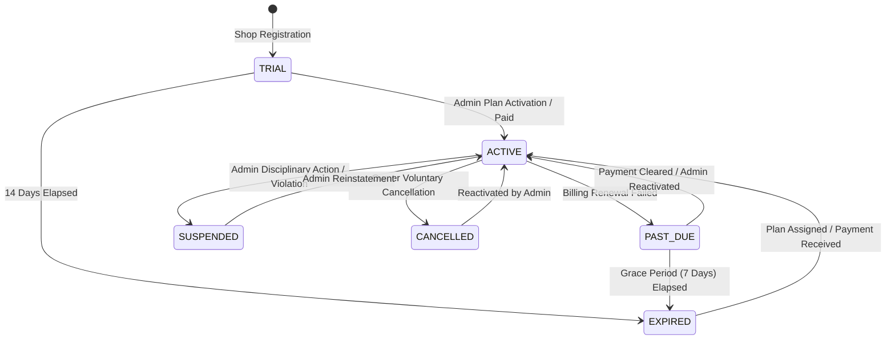

# LocalPickup — Subscription & SaaS Administration Design

## 1. Executive Summary

**LocalPickup** operates as a multi-tenant SaaS platform connecting local printing and stationery shops with collegiate and neighborhood customers for scheduled self-pickup. 

This document defines the subscription architecture, plan entitlement limits, lifecycle state machine, administrative audit trail, and database schema extensions for **Milestone 5: SaaS Administration and Subscription Management**.

---

## 2. Subscription Plans & Entitlement Limits

LocalPickup offers tiered subscription plans tailored to shop volume, catalog depth, and organizational structure. Plan limits are centrally configured in the database rather than hardcoded across route handlers.

### Plan Tiers

| Attribute | **14-Day Free Trial** (`plan_trial`) | **Starter Merchant** (`plan_starter`) | **Professional Shop** (`plan_pro`) | **Enterprise Fleet** (`plan_enterprise`) |
| :--- | :--- | :--- | :--- | :--- |
| **Target Tenant** | New shop onboardings | Small stationery shops | High-volume college xerox centers | Multi-branch printing franchises |
| **Monthly Price** | ₹0 / 14 days | ₹499 / month | ₹1,499 / month | ₹3,999 / month |
| **Max Staff Accounts** | 2 staff members | 3 staff members | 10 staff members | 50 staff members |
| **Max Active Products**| 15 stationery items | 50 stationery items | 250 stationery items | 1,000 stationery items |
| **Analytics Level** | `BASIC` | `BASIC` | `STANDARD` | `ADVANCED` |
| **Bulk Print Pricing** | Standard | Standard | Advanced volume tiers | Custom corporate contracts |
| **Custom Branding** | LocalPickup badge | LocalPickup badge | White-label shop banner | Full custom domain & branding |
| **Priority Support** | Community | Standard email | Priority WhatsApp / Phone | Dedicated account manager |

### Feature Configuration Matrix (`feature_config_json`)

Plan entitlements are represented in SQLite as structured JSON:
```json
{
  "allow_custom_branding": false,
  "allow_volume_discounts": true,
  "allow_priority_queue": true,
  "max_upload_size_mb": 25,
  "export_reports": false
}
```

---

## 3. Subscription Lifecycle State Machine

A shop's subscription status controls order intake capabilities, resource headroom, and platform feature access.



### Supported Subscription Statuses

1. **`TRIAL`**:
   - Initial status assigned upon shop onboarding.
   - Duration: 14 days from registration (`trial_ends_at`).
   - Unrestricted access to Starter-tier features and order placement.
2. **`ACTIVE`**:
   - Fully active paid or admin-sponsored subscription.
   - All plan limits and features fully unlocked.
3. **`PAST_DUE`**:
   - Renewal period lapsed without verified billing.
   - 7-day grace period where incoming orders are still accepted, but a warning banner displays in the shop dashboard.
4. **`EXPIRED`**:
   - Trial or grace period elapsed without an active subscription.
   - **Policy**: Shop cannot accept *new* customer orders (returns HTTP 403). **No data deletion**: all products, existing orders, customer history, and uploaded files remain safely stored and accessible. Existing pending/ready orders can still be completed and verified at the counter.
5. **`SUSPENDED`**:
   - Explicit administrative intervention (e.g. Terms of Service violation, shop closure).
   - Public shop storefront hidden or locked.
   - All incoming order creation blocked (`HTTP 403`).
6. **`CANCELLED`**:
   - Voluntary termination by shop owner or non-renewal.
   - Retains access until `current_period_end`. Afterwards transitions to `EXPIRED`.

### Valid State Transitions

| From Status | Permitted Target Statuses | Trigger / Actor |
| :--- | :--- | :--- |
| **`TRIAL`** | `ACTIVE`, `EXPIRED`, `SUSPENDED`, `CANCELLED` | Admin activation, 14-day expiry, Admin suspension |
| **`ACTIVE`** | `PAST_DUE`, `SUSPENDED`, `CANCELLED`, `ACTIVE` (plan change) | Renewal failure, Admin suspension, Owner cancel, Admin upgrade |
| **`PAST_DUE`** | `ACTIVE`, `EXPIRED`, `SUSPENDED` | Renewal payment, Grace period expiration, Admin suspension |
| **`EXPIRED`** | `ACTIVE`, `TRIAL` (extension), `SUSPENDED` | Plan assignment, Admin trial extension, Admin suspension |
| **`SUSPENDED`** | `ACTIVE`, `EXPIRED`, `CANCELLED` | Admin reinstatement, Admin termination |
| **`CANCELLED`** | `ACTIVE`, `EXPIRED` | Admin plan reactivation |

---

## 4. Subscription vs. Shop Operational Status

It is critical to distinguish between **Subscription Status** and **Shop Operational Status**:
- **Subscription Status** (`shop_subscriptions.status`): Determines commercial license, plan entitlements, staff limits, product catalog limits, and billing validity.
- **Shop Status** (`shops.is_approved` / `shops.is_active`): Determines whether the shop is physically open, verified by local authorities, or accepting counter pickups today.

A shop may be `ACTIVE` in subscription but temporarily closed on Sunday (`is_open = false`). Conversely, an approved shop with an `EXPIRED` subscription is blocked from accepting new pre-orders until its license is renewed.

---

## 5. Upgrade & Downgrade Rules

1. **Upgrades**:
   - Effective immediately upon assignment by Platform Admin.
   - New staff and product limits apply instantaneously.
   - Recorded in `subscription_history` with actor identity and timestamp.
2. **Downgrades**:
   - If a shop currently exceeds the lower plan's limits (e.g., currently has 7 staff members and downgrades to Starter with a limit of 3):
     - The downgrade request is gated on the server.
     - Existing staff accounts and products are **never automatically deleted**.
     - The shopkeeper is required to archive/remove surplus staff or products before the downgrade is finalized, or the admin can approve with an explicit grandfathering note in `subscription_history`.
3. **Plan Change Requests**:
   - Because online payment gateways are intentionally not integrated in this milestone, shop owners submit an in-app upgrade request (`POST /api/shops/:id/subscription/request-change`).
   - The request sets `requested_plan_id` and `requested_at` in `shop_subscriptions`.
   - The Platform Admin reviews pending plan change requests in `/admin` and approves them with a single click.

---

## 6. Administrative Audit Logging

All privileged administrative actions are logged in the append-only `admin_audit_logs` table.

### Audit Log Schema
- `id` (TEXT PRIMARY KEY)
- `actor_user_id` (TEXT NOT NULL REFERENCES users(id))
- `actor_name` (TEXT NOT NULL)
- `action` (TEXT NOT NULL)
- `target_type` (TEXT NOT NULL: `SHOP`, `SUBSCRIPTION`, `PLAN`, `USER`)
- `target_id` (TEXT NOT NULL)
- `details_json` (TEXT)
- `ip_address` (TEXT)
- `created_at` (TEXT NOT NULL)

### Tracked Administrative Actions
- `PLAN_ASSIGNED`: Admin assigns a new subscription tier to a shop.
- `PLAN_REQUEST_APPROVED`: Admin approves a pending upgrade request.
- `STATUS_SUSPENDED`: Admin suspends a shop for policy reasons.
- `STATUS_REACTIVATED`: Admin restores a suspended or expired shop.
- `TRIAL_EXTENDED`: Admin grants additional trial days to a tenant.
- `PLAN_CREATED` / `PLAN_UPDATED`: Admin creates or modifies plan limits.
- `SHOP_APPROVED`: Admin approves a newly registered merchant.

### Confidentiality Guarantee
**Security Constraint**: Passwords, password hashes, JWT tokens, credit card numbers, or cryptographic secrets are **strictly forbidden** from audit log payloads. Audit logs are server-side only and inaccessible to ordinary shop owners or customers.

---

## 7. Database Migration Strategy (Migration 004)

The database schema evolution is executed through `004_subscriptions_admin_audit` in `backend/src/db/migrations.ts`:

1. **`subscription_plans`**: Defines tiers, pricing, resource caps, and feature flags.
2. **`shop_subscriptions`**: Tracks the current plan, active status, billing cycle, and upgrade requests for each shop.
3. **`subscription_history`**: Audit log of all plan and status transitions over time.
4. **`admin_audit_logs`**: Platform-wide administrative action logs.
5. **Backwards Compatibility & Data Preservation**:
   - Existing shops in `shops` are automatically migrated into `shop_subscriptions` on boot.
   - Shops with `subscription_status = 'ACTIVE'` are assigned `plan_starter`.
   - Shops with `subscription_status = 'TRIAL'` are assigned `plan_trial` with a 14-day window.
   - Shops with `subscription_status = 'SUSPENDED'` receive `status = 'SUSPENDED'`.
   - Pre-existing orders, products, and user accounts remain completely untouched.

---

## 8. Rollback and Backup Strategy

1. **Pre-Migration Snapshot**: Before applying migration 004, the existing SQLite database `localpickup.db` and JSON backup are copied with a timestamped snapshot (`localpickup.backup.pre-m5.<timestamp>.db`).
2. **Transaction Isolation**: Migration 004 runs inside an atomic SQLite transaction `BEGIN ... COMMIT;`. If any table creation or data seeding statement encounters an error, the migration rolls back cleanly with `ROLLBACK;`.
3. **Safe Foreign Key Degradation**: All foreign keys utilize `ON DELETE CASCADE` or `ON DELETE SET NULL`, preserving referential integrity without orphan records.
